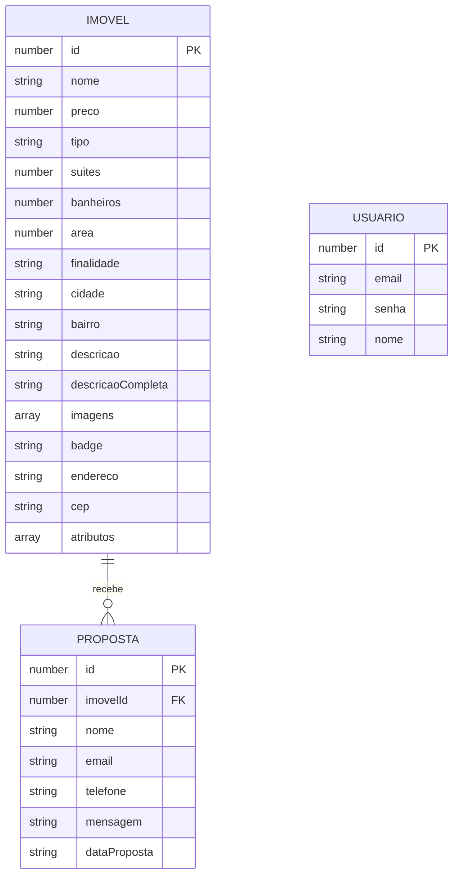
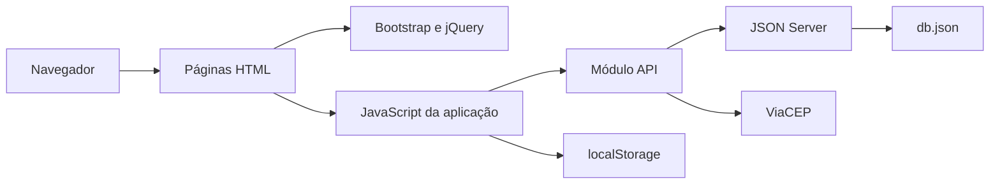

# Especificação Técnica e Arquitetura

## 1. Visão Geral da Arquitetura

A aplicação é um site estático e responsivo desenvolvido com HTML5, CSS3, JavaScript ES6+, Bootstrap 5 e jQuery.

A arquitetura adotada é **cliente-servidor**, utilizando:

- páginas HTML separadas para catálogo, detalhes, cadastro e login;
- JavaScript no navegador para renderização, filtros, interações e validações;
- JSON Server para fornecer uma API REST local em `http://localhost:3000`;
- `db.json` como fonte inicial dos dados de imóveis, propostas e usuários;
- ViaCEP para consulta pública de endereço a partir do CEP;
- `localStorage` para persistir os imóveis favoritados pelo usuário;
- SCSS para geração de estilos CSS, embora as páginas também utilizem folhas de estilo CSS compiladas;
- LiteServer, Concurrently, ESLint e Prettier como ferramentas de desenvolvimento.

Não há autenticação nem backend real implementados; o login e os dados são parte de uma simulação local baseada no JSON Server.

## 2. Estrutura do Projeto

```text
index.html                 Catálogo principal e filtros
page-imovel.html           Detalhes de um imóvel
cadastro-imovel.html       Cadastro e edição de imóveis
login.html                 Tela de autenticação simulada

js/main.js                 Inicialização e comportamento da página principal
js/modules-js/api.js       Abstração das requisições AJAX ao JSON Server e ViaCEP
js/modules-js/jsmodules/
  validacao.js             Validações de formulários

css/css/                  Folhas CSS do projeto
scss/                      Arquivos-fonte Sass/SCSS
db.json                    Dados simulados da API
package.json               Scripts e dependências
img(product)/              Imagens dos imóveis
```

## 3. Modelo de Dados

O modelo está representado pelo arquivo `db.json` e pela API REST simulada pelo JSON Server.



### Entidades

- **Imóvel:** contém as informações exibidas no catálogo e na página de detalhes. Cada imóvel possui preço, tipo, finalidade, características físicas, localização, imagens e atributos.
- **Proposta:** representa o interesse de contato enviado por um visitante sobre um imóvel.
- **Usuário:** contém os dados de acesso usados pela tela de login simulada.

## 4. Fluxo de Execução



### Inicialização

1. Uma página HTML é carregada pelo navegador.
2. O script `js/main.js` aguarda o evento `document.ready`.
3. A aplicação solicita os imóveis à API local.
4. Os dados recebidos são armazenados em memória para permitir filtros sem novas chamadas.
5. Os cards dos imóveis são renderizados dinamicamente com jQuery.

### Consulta e apresentação

O módulo `API` realiza requisições assíncronas com `$.ajax`:

- `GET /imoveis` — lista todos os imóveis;
- `GET /imoveis/:id` — obtém os detalhes de um imóvel;
- `POST /imoveis` — cadastra um imóvel;
- `PUT /imoveis/:id` — atualiza um imóvel;
- `DELETE /imoveis/:id` — remove um imóvel;
- `GET /propostas` — lista propostas;
- `POST /propostas` — envia uma proposta;
- `GET https://viacep.com.br/ws/:cep/json` — consulta um endereço pelo CEP.

## 5. Funcionalidades Principais

- catálogo de imóveis;
- filtros por tipo, cidade, preço máximo e finalidade;
- visualização detalhada em modal ou página dedicada;
- carrossel de imagens;
- cadastro de imóveis;
- envio de propostas;
- consulta de endereço por ViaCEP;
- validação de formulários no navegador;
- persistência local dos favoritos com `localStorage`;
- tela de login simulada.

## 6. Persistência e Integrações

O projeto possui duas formas de persistência e uma integração externa:

- **JSON Server:** persistência dos recursos `imoveis`, `propostas` e `usuarios` em `db.json`;
- **localStorage:** armazenamento do identificador dos imóveis marcados como favoritos;
- **ViaCEP:** integração externa para preenchimento automático de endereço.

Os favoritos não são enviados à API e permanecem disponíveis apenas no navegador do usuário.

## 7. Interface e Estilos

A interface utiliza Bootstrap 5 para componentes básicos e um CSS próprio para o design visual do catálogo, formulários, modal e páginas de detalhes.

O projeto possui arquivos Sass organizados em `scss/` e folhas CSS geradas em `css/`. O script `npm run sass:build` compila SCSS para CSS.

## 8. Desenvolvimento e Execução

Os scripts disponíveis em `package.json` são:

- `npm run sass` — compila SCSS em modo de observação;
- `npm run sass:build` — gera os arquivos CSS compilados;
- `npm run server` — inicia o JSON Server na porta 3000;
- `npm run dev` — executa o Sass, o JSON Server e o LiteServer em paralelo;
- `npm run build` — executa a compilação do SCSS;
- `npm run lint` — executa o ESLint em `js/`;
- `npm run format` — executa o Prettier.
